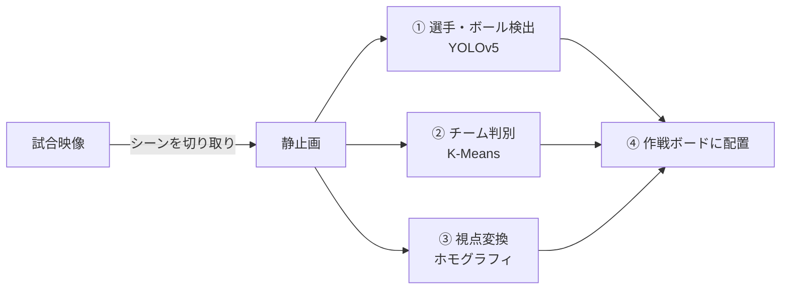

# Football Tactical Board
サッカーの試合映像から、好きなシーンを再現した作戦ボードを生成します。

# Motivation

サッカーをしていた頃、ミーティングで試合を振り返るたびに、作戦ボードのマグネットを毎回並べ直す必要がありました。

選手とボールをシーンごとに毎回並べ直すのは意外と時間がかかり、本来の目的である「戦術の話し合い」の時間を圧迫していました。

この手間をなくすため、試合映像の1シーンから選手とボールの位置を自動で検出し、作戦ボード上に再現するアプリケーションを作りました。


# DEMO

[DEMO Movie](https://youtu.be/C0vk0hYURZQ)


# Features

- 試合映像から好きなシーンを切り取り、作戦ボードに選手・ボールを自動で配置
- ユニフォームの色からチームを判別し、マーカーを色分け
- 配置後もマーカーをドラッグで動かせる
- ペン（黒・赤・青）で矢印や動きを書き込み、消しゴム・全消去で修正できる

画像処理部分のみ（https://github.com/michiy611/Football-Hawk-Eye-View）

# 処理の流れ



| | 処理 | 内容 |
| :---: | --- | --- |
| ① | 選手・ボール検出 | 独自に学習させた **YOLOv5** で、画像内の選手とボールの位置を検出 |
| ② | チーム判別 | 検出した選手の領域を **K-Means** で色分けし、ユニフォームの色を8色のいずれかに分類 |
| ③ | 視点変換 | フィールドのラインを抽出し（**pix2pix**）、中継カメラの向きを推定して、斜めからの映像を真上から見た座標に変換（**ホモグラフィ変換**） |
| ④ | 配置 | 変換後の座標とチームの色をもとに、作戦ボード上にマーカーを表示 |

### YOLOv5 モデルの精度

選手・ボールの画像データで学習したモデルの評価結果（検証用画像 200 枚）

| Class | Precision | Recall | mAP50 | mAP50-95 |
| :---: | :---: | :---: | :---: | :---: |
| all | 0.968 | 0.925 | 0.949 | 0.717 |
| player | 0.987 | 0.985 | 0.994 | 0.854 |
| ball | 0.949 | 0.866 | 0.904 | 0.58 |


# Installation

### 1. リポジトリを取得

```bash
git clone https://github.com/michiy611/Football-Tactical-Board.git
cd Football-Tactical-Board/Flask
```

### 2. 学習済みモデルを配置

[Releases](https://github.com/michiy611/Football-Tactical-Board/releases) から重みファイルをダウンロードし、`Flask/weights/` に以下の構成で配置します。

```
Flask/weights/
├── best.pt                     # YOLOv5（選手・ボール検出）
├── deep_network.pth            # カメラ姿勢推定用の特徴抽出ネットワーク
├── data/
│   ├── worldcup2014.mat
│   └── deep/feature_camera_91k.mat
└── pytorch-two-GAN-models/
    └── soccer_seg_detection_pix2pix/
        ├── detec_latest_net_G.pth
        └── seg_latest_net_G.pth
```

### 3. ライブラリをインストール

```bash
pip install torch==2.8.0 torchvision==0.23.0 --index-url https://download.pytorch.org/whl/cpu
pip install -r requirements.txt
```

# Usage

```bash
$env:TORCH_FORCE_NO_WEIGHTS_ONLY_LOAD = "1"

python app.py
```

ブラウザで http://127.0.0.1:5000 を開きます。


# Credits

本プロジェクトは以下のオープンソースを利用しています。

- [YOLOv5](https://github.com/ultralytics/yolov5) — 選手・ボールの検出
- [pix2pix](https://github.com/junyanz/pytorch-CycleGAN-and-pix2pix) — フィールドのライン抽出
